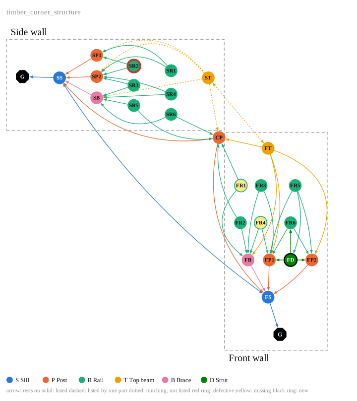

============================================================
Graph Drawing
============================================================

.. start-badges

.. image:: https://img.shields.io/badge/License-MIT-blue.svg
    :target: https://github.com/augmentedfabricationlab/graph_drawing/blob/master/LICENSE
    :alt: License MIT

.. image:: https://img.shields.io/badge/docs-latest-3070b3.svg
    :target: https://augmentedfabricationlab.github.io/graph_drawing/latest/
    :alt: Documentation

.. end-badges

Schematic drawings of graphs in Rhino, in Grasshopper, as SVG and as PDF.

Any graph whose nodes and edges carry a few styling attributes can be drawn,
for example a sequence of actions, a program of interventions, or the members of a
structure and their connections. One reader comes with the package: support
graphs of timber frames given as boxes in JSON (schema 2.1.0, see
``data/timber_corner_structure.json``), drawn after the support hierarchy graph of Bruun et al. 2024
(Construction Robotics 8:20, Fig. 7): which member rests on which, wall by wall.

**Documentation:** https://augmentedfabricationlab.github.io/graph_drawing/latest/

Requirements
------------

* Windows 10/11
* Rhino 8 / Grasshopper (Python 3)
* `Anaconda Python <https://www.anaconda.com/download>`_
* `Visual Studio Code <https://code.visualstudio.com/>`_
* `Github Desktop <https://desktop.github.com/>`_

The package needs ``compas>=2.15.1``. ``compas_model`` is needed only for
``from_model`` (``pip install -e .[model]``).

Installation
------------

* Using GitHub Desktop, clone the `graph_drawing <https://github.com/augmentedfabricationlab/graph_drawing>`_
  repository into ``C:/Users/your_user_name/workspace/projects``.

* In an Anaconda prompt, install it into your environment::

    (your_env_name) pip install -e C:/Users/your_user_name/workspace/projects/graph_drawing

* Find the Python of Rhino 8::

    (your_env_name) python -m compas_rhino.print_python_path

  It looks like ``C:/Users/your_user_name/.rhinocode/py39-rh8/python.exe``. Install the package there as well::

    (your_env_name) C:/Users/your_user_name/.rhinocode/py39-rh8/python.exe -m pip install -e C:/Users/your_user_name/workspace/projects/graph_drawing

  Or, in Rhino 8, open any Python script, go to Tools/Options and add the ``src`` folder of the repository
  to the Python path. The Grasshopper component also finds ``src`` on its own (see below).

* Run the tests from the repository folder::

    pytest

Main concepts
-------------

A drawing is made in three steps, the same for every kind of graph:

1. **A graph.** A ``compas.datastructures.Graph`` whose nodes and edges carry styling attributes.
   ``frames`` makes one from a JSON of parts as boxes, ``from_model`` from a compas_model model,
   ``steps`` from a list of steps.
2. **A layout.** ``layouts.support`` places the members of a frame in the manner of Bruun et al.,
   ``layouts.layered`` puts the nodes of a directed graph in layers along its edges.
3. **A drawing.** ``draw`` turns graph and positions into a ``Drawing``: a list of plain items
   (circles, polygons, lines, text). The same items become SVG, PDF, Rhino geometry and the
   drawing on the Grasshopper canvas, so all four look the same.

.. code-block:: python

    from graph_drawing import frames, steps, layouts, draw

    # the support graph of a frame
    drawing = frames.drawing("data/timber_corner_structure.json")
    drawing.to_pdf("corner.pdf")

    # a sequence of steps, or any directed graph of steps
    g = steps(["Release the joints", "Prop the plate", "Lift the wall", "Withdraw post_3"],
              edges=[(0, 2), (1, 2), (2, 3)])
    pos, regions = layouts.layered(g)
    open("steps.svg", "w").write(draw(g, pos, regions, title="post exchange").to_svg())

Any directed graph of steps is drawn the same way: ``steps({key: label, ...}, edges=[(a, b), ...])``.
``models.drawing(model)`` draws a compas_model model with the state of an intervention, as computed with
`intervention_grammar <https://github.com/augmentedfabricationlab/intervention_grammar>`_.
The styling attributes, the attribute names shared with intervention_grammar and the way to read a
support drawing are in the `documentation <https://augmentedfabricationlab.github.io/graph_drawing/latest/usage/>`__.

In Rhino and Grasshopper
------------------------

.. code-block:: python

    from compas.scene import Scene
    import graph_drawing.rhino  # registers the drawing for Rhino and Grasshopper
    from graph_drawing import frames

    scene = Scene()
    obj = scene.add(frames.drawing(json_path), unit=0.2)
    geometry = scene.draw()
    colors = obj.colors  # one per piece of geometry, for a Custom Preview

``rhino/`` holds a Grasshopper component built on the package: in Grasshopper add a **Script** component,
choose **Python 3**, paste ``rhino/stub.py``, save the .gh file in the repository's ``rhino`` folder, and
connect a **File Path** with ``data/timber_corner_structure.json`` to ``json_path``. Its inputs and outputs are
described in the `documentation <https://augmentedfabricationlab.github.io/graph_drawing/latest/rhino/>`__.

Contributing
------------

Make sure you setup your local development environment correctly:

* Clone the `graph_drawing <https://github.com/augmentedfabricationlab/graph_drawing>`__ repository.
* Install development dependencies and make the project accessible from Rhino:

::

    pip install -r requirements-dev.txt
    invoke add-to-rhino

**You're ready to start working!**

During development, use tasks on the
command line to ease recurring operations:

* ``invoke clean``: Clean all generated artifacts.
* ``invoke check``: Run various code and documentation style checks.
* ``invoke docs``: Generate documentation.
* ``invoke test``: Run all tests and checks in one swift command.
* ``invoke add-to-rhino``: Make the project accessible from Rhino.
* ``invoke``: Show available tasks.

For more details, check the `Contributor's Guide <CONTRIBUTING.rst>`_.

The tests run the pure Python part on Python 3.9 (the version of Rhino 8) and later. Everything that needs
Rhino, ``graph_drawing.rhino`` and the component in ``rhino/``, is not covered by them.
The documentation is published to GitHub Pages on every push to master.

Credits
-------------

The first version of the assembly graph component built on ``LayoutAssemblyGraph`` by Anders Holden Deleuran
(Apache License 2.0, 2016). The drawing follows the support hierarchy graph of Bruun et al. 2024,
Construction Robotics 8:20, Fig. 7.

This package was created by Tizian Rein <tizian.rein@tum.de> `@tizianrein <https://github.com/tizianrein>`_ at `@augmentedfabricationlab <https://github.com/augmentedfabricationlab>`_
