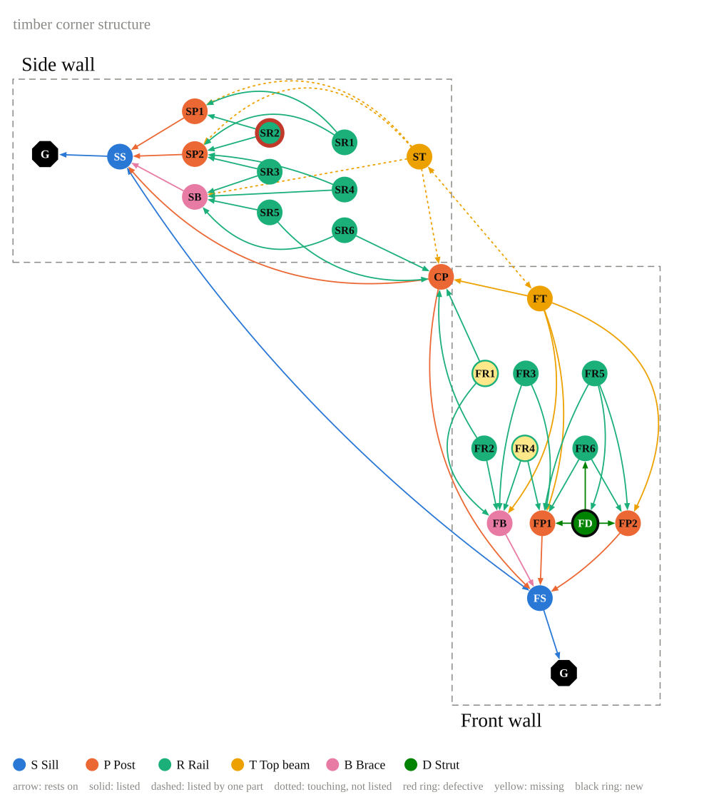

# Graph Drawing

<p class="lead">
Schematic drawings of graphs in Rhino, in Grasshopper, as SVG and as PDF.
</p>

Any graph whose nodes and edges carry a few styling attributes can be drawn:
a sequence of actions, a program of interventions, the members of a structure
and their connections. A drawing becomes SVG, PDF, Rhino geometry or a
picture on the Grasshopper canvas.

<figure markdown>
  
  <figcaption>The support graph of a timber corner structure, after Bruun et al. 2024: which member rests on which, wall by wall.</figcaption>
</figure>

A drawing is made in three steps:

1. **A graph.** A `compas.datastructures.Graph` whose nodes and edges carry
   styling attributes. [`frames`][graph_drawing.frames] makes one from a JSON
   of parts as boxes, [`from_model`][graph_drawing.models.from_model] from a
   compas_model model, [`steps`][graph_drawing.models.steps] from a list of steps.
2. **A layout.** [`layouts.support`][graph_drawing.layouts.support] places the
   members of a frame in the manner of Bruun et al.,
   [`layouts.layered`][graph_drawing.layouts.layered] puts the nodes of a
   directed graph in layers along its edges.
3. **A drawing.** [`draw`][graph_drawing.drawing.draw] turns graph and
   positions into a [`Drawing`][graph_drawing.drawing.Drawing]: a list of plain
   items (circles, polygons, lines, text).

```python
from graph_drawing import steps, layouts, draw

g = steps(["Release", "Lift the wall", "Withdraw post_3", "Insert a new post"])
pos, regions = layouts.layered(g)
drawing = draw(g, pos, regions, title="exchange of a post")

with open("steps.svg", "w") as f:
    f.write(drawing.to_svg())
drawing.to_pdf("steps.pdf")
```

See [Drawing graphs](usage.md) and [Rhino and Grasshopper](rhino.md).

## Credits

The drawing of support graphs follows the support hierarchy graph of
Bruun et al. 2024, *Construction Robotics* 8:20, Fig. 7. The first version of
the Grasshopper component built on `LayoutAssemblyGraph` by Anders Holden
Deleuran (Apache License 2.0, 2016).

Graph Drawing is developed by Tizian Rein at the
[Professorship of Digital Fabrication](https://www.arc.ed.tum.de/df),
Technical University of Munich.
