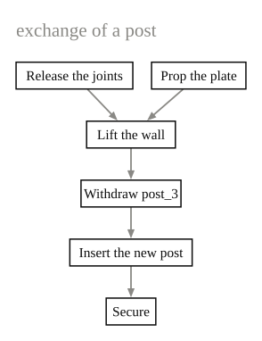
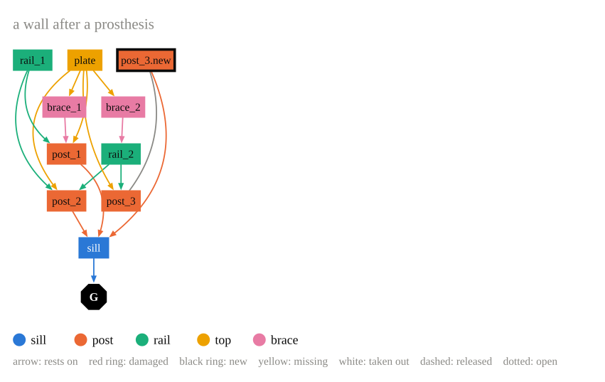

# Drawing graphs

## Steps

[`steps`][graph_drawing.models.steps] makes a graph of labelled steps, as a
chain or as any directed graph. [`layouts.layered`][graph_drawing.layouts.layered]
puts the steps in layers along the edges and orders each layer so that edges
cross as little as possible.

```python
from graph_drawing import steps, layouts, draw

g = steps(
    {"r": "Release the joints", "p": "Prop the plate", "l": "Lift the wall",
     "w": "Withdraw post_3", "n": "Insert the new post", "s": "Secure"},
    edges=[("r", "l"), ("p", "l"), ("l", "w"), ("w", "n"), ("n", "s")],
)
pos, regions = layouts.layered(g)
drawing = draw(g, pos, regions, title="exchange of a post")
```

<figure markdown>
  
</figure>

## Models

[`models.drawing`][graph_drawing.models.drawing] draws a
[compas_model](https://github.com/blockresearchgroup/compas_model) `Model`
whose graph carries the state of an intervention, for example a state computed
with [Intervention Grammar](https://augmentedfabricationlab.github.io/intervention_grammar/).
Members become boxes coloured by type, connections become arrows from the
carried member to the carrying one.

```python
from graph_drawing import models

drawing = models.drawing(model, title="a wall after a prosthesis")
```

<figure markdown>
  
</figure>

[`from_model`][graph_drawing.models.from_model] gives the styled graph alone,
for another layout. graph_drawing does not import intervention_grammar; the
two share only these attribute names:

| On | Attribute | Values |
|---|---|---|
| element nodes | `fabric` | `"original"`, `"new"` (black ring) |
| element nodes | `condition` | `"sound"`, `"damaged"` (red ring) |
| element nodes | `placement` | `"in"`, `"inserted"`, `"out"` (white, dashed), `"missing"` (yellow) |
| element nodes | `type` | the role of the member, any name (colour) |
| element nodes | `grounded` | `True`: an arrow to the ground node |
| connections | `joint` | a joint description |
| connections | `state` | `"secured"`, `"released"` (dashed), `"open"` (dotted) |
| connections | `at` | `{element name: station}` |
| connections | `support` | `(carried, carrier)` or `"both"`: the arrow |

## Frames

[`frames.drawing`][graph_drawing.frames.drawing] reads the parts of a frame
from JSON, as boxes with their dimensions and rotations and the connections
each part lists, finds the contacts between the boxes and draws which part
rests on which. The format is that of `data/timber_corner_structure.json`
in the repository (schema 2.1.0). The drawing on the [home page](index.md) is
this file:

```python
from graph_drawing import frames

drawing = frames.drawing("data/timber_corner_structure.json")
drawing.to_pdf("corner.pdf")
```

[`frames.report`][graph_drawing.frames.report] lists what the JSON and the
geometry disagree on, and [`frames.focus`][graph_drawing.frames.focus] shows
how every part relates to a selected one: what it rests on, what rests on it,
and what loses all support from below once it is taken out.

### Reading a support drawing

* Every wall gets a region (dashed box), placed like a plan seen from above.
  Inside a region the members stand in columns from the outside in: ground,
  sills, posts, braces and struts, one column per rail height, top beams.
  Members of two walls stand between the two regions, members of no wall in
  the middle.
* Codes: wall letter, type letter, number along the wall (`FR3` is the front
  wall, rail 3), `C` corner, `G` ground.
* Node colour is the member type, always together with the type letter. Red
  ring: defective, yellow: missing, black ring: new.
* An arrow points from the carried part to the carrying part, coloured like
  the carried part. Solid: listed by both parts, dashed: listed by one,
  dotted: touching but not listed, red: listed but not touching.

## Any graph

[`draw`][graph_drawing.drawing.draw] draws any `compas.datastructures.Graph`
with positions for its nodes. It reads these attributes:

| On | Attributes |
|---|---|
| nodes | `label`, `fill`, `stroke` and `stroke_width` (a ring), `text_color`, `label_size`, `bold`, `shape` (`"circle"`, `"octagon"`, `"box"`), `radius`, `outline`, `fixed` (never fades in a focus) |
| edges | `color`, `width`, `dash` (`"dash"`, `"dot"`), `arrow` (`"head"`, `"both"`), `source` (the edge it stands for), `order` (drawing order) |

Edges are drawn from their first node to their second. Curves avoid nodes
first and crossings second, and stay straight where that is clear.

## SVG and PDF

A [`Drawing`][graph_drawing.drawing.Drawing] writes itself as SVG text or as a
one-page PDF, both as vector graphics. It is a COMPAS `Data` object as well,
so it saves and loads as JSON.

```python
with open("drawing.svg", "w") as f:
    f.write(drawing.to_svg())
drawing.to_pdf("drawing.pdf")
```
